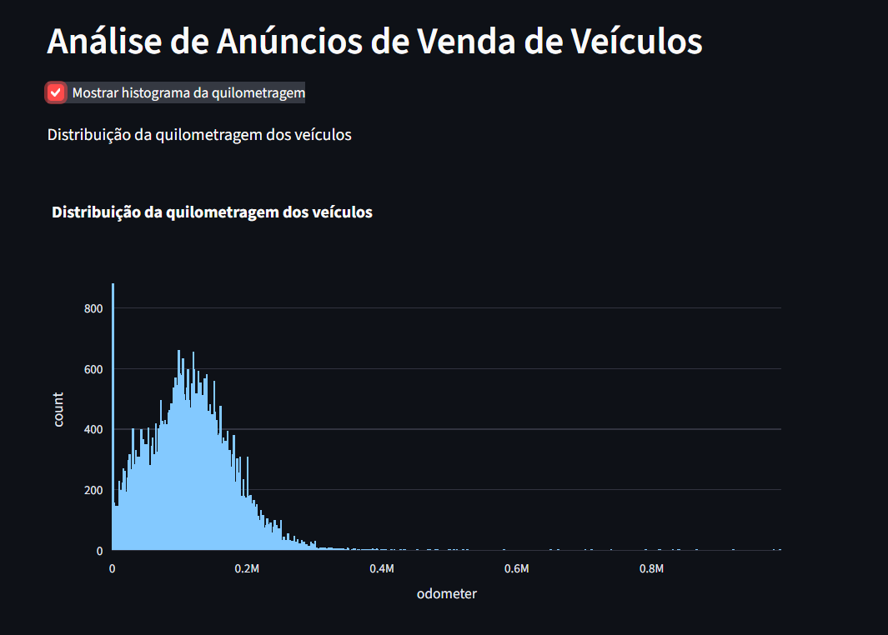
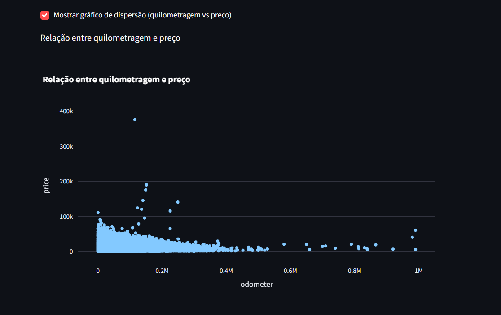

# Vehicles Market Analysis Web Application

---

## Project Overview

This project consists of an interactive web application developed with Streamlit for exploratory analysis of vehicle advertisement data.

The application allows users to visualize key characteristics of the dataset through interactive charts and controls, making it easier to identify patterns and relationships between vehicle attributes.

The project combines data analysis, visualization, and web deployment techniques to provide an accessible analytical tool for users.

---

## Business Problem

Online vehicle marketplaces contain large volumes of listings, making it difficult to quickly identify trends and relationships within the data.

This application helps users explore vehicle advertisement information by providing interactive visualizations that reveal:

- Mileage distribution
- Relationships between vehicle price and mileage
- General characteristics of listed vehicles
- Data patterns through interactive exploration

Such insights can support market analysis and data-driven decision-making.

---

## Dataset

The project uses the dataset:

- `vehicles_us.csv`

The dataset contains information about vehicle advertisements, including price, model year, mileage, condition, fuel type, transmission type, and other vehicle characteristics.

---

## Technologies Used

- Python
- Pandas
- Plotly Express
- Streamlit
- Jupyter Notebook
- Git
- GitHub
- Render

---

## Exploratory Data Analysis

Before building the web application, an exploratory analysis was conducted to understand the dataset structure and identify important variables.

The analysis included:

- Data cleaning and preprocessing
- Missing value handling
- Exploratory visualizations
- Variable relationship analysis
- Dataset quality assessment

The complete exploratory analysis can be found in:

```text
notebooks/EDA.ipynb
```

---

## Web Application Features

The application provides:

- Interactive histogram visualization
- Interactive scatter plot visualization
- Dynamic user controls through checkboxes
- Real-time chart generation
- Responsive web interface

---

## Application Screenshots

### Mileage Distribution Histogram



Interactive histogram showing the distribution of vehicle mileage.

---

### Price vs Mileage Scatter Plot



Interactive scatter plot illustrating the relationship between vehicle mileage and price.

---

## Live Demo

The application is available online:

https://vehicles-app-epdt.onrender.com

---

## How to Run Locally

1. Clone the repository:

```bash
git clone https://github.com/etienne-94/vehicles-app.git
```

2. Navigate to the project directory:

```bash
cd vehicles-app
```

3. Install dependencies:

```bash
pip install -r requirements.txt
```

4. Launch the Streamlit application:

```bash
streamlit run app.py
```

---

## Repository Structure

```text
vehicles-app/
│
├── app.py
├── vehicles_us.csv
├── requirements.txt
├── README.md
├── .gitignore
│
├── notebooks/
│   └── EDA.ipynb
│
├── .streamlit/
│   └── config.toml
│
└── images/
    ├── histogram.png
    └── scatter_plot.png
```

---

## Dataset Availability

The dataset used in this project was provided by TripleTen for educational purposes and is included exclusively for learning and portfolio development.

---

## Author

Etienne Viegas dos Santos

Data Analytics Student | TripleTen

GitHub: https://github.com/etienne-94
